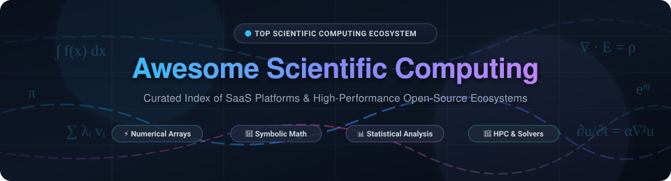

  

  
  
  
  
  
  

---

# 🔬 Awesome Scientific Computing ⚡

> **A comprehensive, curated directory of enterprise SaaS platforms and leading open-source numerical computing ecosystems.**  
> *Covering array manipulation, linear algebra, symbolic mathematics, partial differential equations, optimization, Bayesian inference, and publication-grade visualization.*

---

## 📑 Table of Contents

- [🌐 Sector Overview & Market Dynamics](#-sector-overview--market-dynamics)
- [💼 Enterprise & Commercial SaaS Platforms](#-enterprise--commercial-saas-platforms)
- [🔓 Open-Source Scientific Computing Ecosystem](#-open-source-scientific-computing-ecosystem)
  - [⭐ Top Repositories by Popularity](#-top-repositories-by-popularity)
  - [🧮 Domain-Specific Numerical Libraries](#-domain-specific-numerical-libraries)
- [🎯 SEO & Ecosystem Keywords](#-seo--ecosystem-keywords)
- [🤝 How to Contribute](#-how-to-contribute)
- [⭐ Star History](#-star-history)
- [💖 Support & Sponsoring](#-support--sponsoring)
- [📜 Disclaimer](#-disclaimer)

---

## 🌐 Sector Overview & Market Dynamics

- **Market Size & Growth:** The global scientific and technical computing software market is currently valued at approximately **$18.5 Billion to $22.4 Billion**, projected to expand at a Compound Annual Growth Rate (CAGR) of **9.8% to 12.4%** through 2032. Growth is fueled by high-performance computing (HPC) cloud transformations, hardware acceleration (GPUs/TPUs), and the pervasive adoption of AI/ML surrogate models across engineering, genomics, and climate science.
- **Market Structure & Fragmentation:** The industry displays a **hybrid, bifurcated structure**. The **commercial engineering simulation and regulatory clinical analytics core is highly concentrated**—entrenched enterprise giants (IBM, PTC, SAS Institute, MathWorks) maintain massive competitive moats powered by decades of proprietary numerical solvers, specialized industry toolboxes, and regulatory accreditation (e.g., FDA CDISC standards). In contrast, the **academic, research, and data science sectors are moderately to highly fragmented**, with open-source ecosystems (Python SciPy/PyData stack, Julia, Rust Arrow/Polars) setting modern algorithmic standards and driving transparent, reproducible research without vendor lock-in.

---

## 💼 Enterprise & Commercial SaaS Platforms

Below is a detailed comparison of industry-standard commercial scientific computing environments.  
*Sorted in descending order by estimated company size (valuation / annual revenue).*

| 🏢 Platform | 💰 Company Size (Valuation / Revenue) | 🏷️ Starting Tier Pricing | 🎁 Free Tier / Trial Limits | 🔍 Core Capabilities |
| :--- | :--- | :--- | :--- | :--- |
| **[IBM SPSS Statistics](https://www.ibm.com/products/spss-statistics)** | **~$215B Market Cap** *(~$62.5B Annual Revenue)* | **$109.00/month per user** *(SPSS Statistics Subscription Base edition, monthly billing)* | **30-Day Free Trial** *(full access to Base desktop algorithms, syntax editor, and data preparation modules; no credit card required)* | Advanced statistical hypothesis testing, linear/non-linear modeling, survey analysis, and automated decision-tree generation. |
| **[PTC Mathcad Prime](https://www.ptc.com/en/products/mathcad)** | **~$22B Market Cap** *(~$2.3B Annual Revenue)* | **$865.00/year per user** *(Mathcad Prime Individual Subscription license)* | **30-Day Full Trial → Mathcad Express** *(reverts permanently to Mathcad Express: free forever for basic calculations and 2D/3D plots, excluding solve blocks, programming, and symbolics)* | Engineering calculation notebook with live mathematical notation, automatic unit consistency checking, and CAD/Excel integration. |
| **[SAS (Viya / Analytics)](https://www.sas.com/)** | **~$18B Estimated Valuation** *(~$3.2B Annual Revenue)* | **$8,500.00/year per user** *(SAS Analytics Pro Commercial tier; $0 for qualifying students/professors)* | **14-Day Viya Cloud Trial / Free Academics** *(14-day SAS Viya cloud trial with 4 vCPUs; SAS OnDemand for Academics is 100% free forever for higher-ed with 5GB cloud storage)* | Enterprise-scale statistical modeling, econometrics, clinical trial reporting (CDISC/FDA compliance), and predictive analytics pipelines. |
| **[MATLAB](https://www.mathworks.com/products/matlab.html)** | **~$14B Estimated Valuation** *(~$1.45B Annual Revenue)* | **$940.00/year** or **$2,350 perpetual** *(Commercial Standard Individual; Home use at $149 perpetual; Student at $49 perpetual)* | **30-Day Full Trial** *(unrestricted access to MATLAB desktop, Simulink, 100+ add-on toolboxes, and 5GB MATLAB Drive cloud storage)* | Matrix-based numerical computing environment, dynamic control systems simulation with Simulink, embedded code generation, and industrial toolboxes. |
| **[JMP](https://www.jmp.com/)** | **~$800M Estimated Valuation** *(~$180M Annual Revenue)* | **$1,475.00/year per user** *(JMP Standard annual subscription; JMP Pro starts at $2,185/year)* | **30-Day Free Trial** *(full-featured desktop trial on Windows/macOS with complete interactive data visualization, profilers, and DOE tools)* | Interactive visual statistical discovery, industrial Design of Experiments (DOE), Six Sigma quality analytics, and exploratory data profiling. |
| **[Posit Workbench / Cloud](https://posit.co/products/enterprise/workbench/)** | **~$700M Estimated Valuation** *(~$75M Annual Revenue)* | **$5.00/month per user** *(Posit Cloud Plus; On-prem Posit Workbench starts at $10,000/year for 5 concurrent users)* | **Free Forever Cloud Plan** *(Posit Cloud Free tier includes 25 project-hours/month, 1 CPU, 1 GB RAM, max 50 projects; or 45-day evaluation for Workbench on-prem)* | Enterprise-grade centralized server environment for R, Python, and Julia; Quarto publishing, collaborative data science, and RStudio IDE hosting. |
| **[Wolfram Mathematica](https://www.wolfram.com/mathematica/)** | **~$500M Estimated Valuation** *(~$120M Annual Revenue)* | **$2,070.00/year** or **$5,175 perpetual** *(Commercial Standard; Home Edition at $195/year or $390 perpetual)* | **15-Day Free Trial** *(unrestricted access to desktop Mathematica and Wolfram Cloud with 2,000 Cloud Compute Credits included)* | The gold standard in symbolic mathematics, computer algebra, calculus solving, differential systems, and curated knowledge-based computation. |
| **[Stata](https://www.stata.com/)** | **~$300M Estimated Valuation** *(~$50M Annual Revenue)* | **$1,145.00/year per user** *(Corporate Stata/BE Basic Edition; Govt/Non-Profit at $765/year; Faculty at $225/year)* | **30-Day Evaluation License** *(available upon verified institutional/organizational form request; handles up to 2,048 variables and 2B observations)* | Statistical software for econometrics, public health, and social sciences; specializes in panel data, longitudinal analysis, and survival models. |
| **[Maple](https://www.maplesoft.com/)** | **~$150M Parent Market Cap** *(~$55M Annual Revenue)* | **$1,490.00/year lease** or **$3,490 perpetual** *(Commercial Individual; Personal at $239 perpetual; Academic at $125/year)* | **15-Day Full-Featured Trial** *(complete access to symbolic math engine, numerical ODE/PDE solvers, and interactive technical worksheet authoring)* | Advanced symbolic and numeric math software, technical document authoring, education mathematics, and physical model simulation via MapleSim. |
| **[OriginLab Origin](https://www.originlab.com/)** | **~$100M Estimated Valuation** *(~$25M Annual Revenue)* | **$650.00/year lease** or **$1,095 perpetual** *(Commercial Single-User Node-Locked; Academic at $250 perpetual; Pro at $1,995 perpetual)* | **21-Day Evaluation Trial** *(unrestricted access to Origin and OriginPro features; exports will include evaluation watermarks once expired)* | Publication-quality 2D/3D scientific graphing, non-linear curve fitting, peak analysis, spectroscopy data processing, and lab instrument integration. |

---

## 🔓 Open-Source Scientific Computing Ecosystem

The open-source numerical ecosystem forms the foundational engine for modern research, AI, and scientific breakthroughs.  
Every repository below includes a social Stars_Badge linking directly to its GitHub stargazers page.

### ⭐ Top Repositories by Popularity

*Sorted in descending order by GitHub stargazers.*

1. **[scikit-learn](https://github.com/scikit-learn/scikit-learn)**   
   **The premier machine learning library for Python** — BSD-3-Clause licensed. Delivers unified, battle-tested algorithms for classification, regression, clustering, dimensionality reduction, model evaluation, and dataset preprocessing across research disciplines.

2. **[pandas](https://github.com/pandas-dev/pandas)**   
   **The foundational tabular data analysis library for Python** — BSD-3-Clause licensed. Provides fast `DataFrame` and `Series` structures with labeled indexing, multi-dimensional alignment, flexible group-by aggregations, time-series mechanics, and data wrangling utilities.

3. **[Julia](https://github.com/JuliaLang/julia)**   
   **High-performance dynamic language for technical computing** — MIT licensed. Solves the "two-language problem" by marrying Python-like expressive mathematical syntax with C-speed via LLVM JIT compilation and multiple dispatch. The primary modern alternative to MATLAB in aerospace, finance, and climate modeling.

4. **[Polars](https://github.com/pola-rs/polars)**   
   **Blazingly fast multi-threaded DataFrame engine** — MIT licensed. Written in Rust on top of the Apache Arrow columnar format. Provides lazy evaluation, query optimization, vectorized SIMD execution, and out-of-core streaming for heavy datasets.

5. **[JAX](https://github.com/jax-ml/jax)**   
   **Composable transformations of Python+NumPy programs** — Apache-2.0 licensed. Developed by Google, JAX offers reverse-mode and forward-mode automatic differentiation (`grad`), vectorization (`vmap`), parallelization (`pmap`), and JIT compilation via XLA for accelerators.

6. **[NumPy](https://github.com/numpy/numpy)**   
   **The fundamental package for scientific computing with Python** — BSD-3-Clause licensed. Introduces the contiguous N-dimensional `ndarray` data structure, vectorized broadcasting, linear algebra solvers (BLAS/LAPACK bindings), and random distribution generators.

7. **[Matplotlib](https://github.com/matplotlib/matplotlib)**   
   **The gold standard publication-quality plotting library** — PSF licensed. Provides complete, pixel-level control over scientific 2D and 3D figures, with multiple rendering backends for interactive desktops, web dashboards, and vector PDF/SVG publication exports.

8. **[pybind11](https://github.com/pybind/pybind11)**   
   **Seamless operability between C++11 and Python** — BSD-3-Clause licensed. Header-only library used universally across scientific software to expose high-performance native C++ algorithms and NumPy buffers directly to Python.

9. **[NetworkX](https://github.com/networkx/networkx)**   
   **Network analysis and complex graph theory in Python** — BSD-3-Clause licensed. Implements graph data structures, centrality measures, shortest paths, clustering coefficients, and random graph generators for biological and social network analysis.

10. **[JupyterLab](https://github.com/jupyterlab/jupyterlab)**   
    **Next-generation modular web-based interactive development environment** — BSD-3-Clause licensed. Extensible computational interface for notebooks, code editors, interactive terminals, data viewers, and collaborative research teams.

11. **[SciPy](https://github.com/scipy/scipy)**   
    **Core scientific algorithms library for Python** — BSD-3-Clause licensed. Features numerical routines for optimization (`scipy.optimize`), numerical integration (`scipy.integrate`), interpolation (`scipy.interpolate`), Fourier transforms, signal filtering, and statistics.

12. **[SymPy](https://github.com/sympy/sympy)**   
    **Computer algebra system (CAS) in pure Python** — BSD-3-Clause licensed. Evaluates exact symbolic mathematics, algebraic calculus, matrix expressions, Taylor expansions, and differential equations, with automated C/Fortran code generation.

13. **[Dask](https://github.com/dask/dask)**   
    **Parallel computing with dynamic task scheduling** — BSD-3-Clause licensed. Scales NumPy arrays, pandas DataFrames, and custom task graphs across multi-core CPUs and distributed HPC clusters without modifying standard syntax.

14. **[Jupyter Notebook](https://github.com/jupyter/notebook)**   
    **The classic reproducible interactive notebook standard** — BSD-3-Clause licensed. Combines live code execution, rich narrative markdown, LaTeX mathematical notation, and interactive figures into a shareable document.

15. **[CuPy](https://github.com/cupy/cupy)**   
    **NumPy and SciPy for GPU acceleration** — MIT licensed. Delivers drop-in array operations executed directly on NVIDIA CUDA and AMD ROCm GPUs, achieving orders-of-magnitude acceleration for matrix operations and FFTs.

16. **[statsmodels](https://github.com/statsmodels/statsmodels)**   
    **Statistical modeling and econometrics in Python** — BSD-3-Clause licensed. Specializes in statistical inference, ordinary least squares (OLS), generalized linear models (GLM), time-series analysis (ARIMA/VAR), and ANOVA tables.

17. **[Numba](https://github.com/numba/numba)**   
    **LLVM-based JIT compiler for Python and NumPy** — BSD-2-Clause licensed. Decorates computational Python functions with `@jit` to generate native machine code on the fly, eliminating Python loop overhead for scientific numerical algorithms.

18. **[PyMC](https://github.com/pymc-devs/pymc)**   
    **Bayesian modeling and probabilistic programming in Python** — Apache-2.0 licensed. Enables intuitive statistical model specification and parameter inference using Hamiltonian Monte Carlo (HMC) and the No-U-Turn Sampler (NUTS).

19. **[Qiskit](https://github.com/Qiskit/qiskit)**   
    **Quantum scientific computing SDK** — Apache-2.0 licensed. Open-source framework for building, optimizing, and simulating quantum circuits, quantum information algorithms, and interfacing with physical superconducting quantum processors.

20. **[OpenBLAS](https://github.com/OpenMathLib/OpenBLAS)**   
    **Optimized Basic Linear Algebra Subprograms (BLAS)** — BSD-3-Clause licensed. Hand-tuned assembly acceleration for matrix-matrix multiplication (GEMM), matrix factorizations, and vector operations across modern CPU architectures.

21. **[Astropy](https://github.com/astropy/astropy)**   
    **Astronomy and astrophysics core library for Python** — BSD-3-Clause licensed. Standardizes astronomical coordinate frames, physical units and constants manipulation, FITS file parsing, and cosmological distance modeling.

22. **[Biopython](https://github.com/biopython/biopython)**   
    **Computational biology and bioinformatics toolset** — Biopython License. Facilitates genetic sequence alignment, structural macromolecule (PDB) analysis, population genetics, and NCBI GenBank automated parsing.

23. **[xarray](https://github.com/pydata/xarray)**   
    **N-dimensional labeled arrays and datasets** — Apache-2.0 licensed. Brings labeled dimensions, coordinate metadata, and vectorized split-apply-combine methods to multi-dimensional data in climate, weather, and geoscience research.

24. **[DifferentialEquations.jl](https://github.com/SciML/DifferentialEquations.jl)**   
    **High-performance differential equation solvers in Julia** — MIT licensed. Multi-purpose numerical suite for solving ordinary (ODEs), stochastic (SDEs), delay (DDEs), and differential-algebraic equations (DAEs) with adjoint sensitivity analysis.

25. **[Stan](https://github.com/stan-dev/stan)**   
    **State-of-the-art probabilistic programming language** — BSD-3-Clause licensed. Employs advanced Markov Chain Monte Carlo methods for Bayesian statistical inference and parameter estimation with R, Python, and Julia interfaces.

26. **[SageMath](https://github.com/sagemath/sage)**   
    **Comprehensive open-source mathematics software system** — GPL-3.0 licensed. Combines dozens of mathematical engines (GAP, PARI/GP, Singular, Maxima, FLINT) under a single Python-based environment for pure and applied mathematics.

27. **[Zarr](https://github.com/zarr-developers/zarr-python)**   
    **Chunked, compressed N-dimensional array storage** — MIT licensed. Cloud-optimized storage format for petabyte-scale numerical datasets across distributed storage backends (AWS S3, Google Cloud Storage, local NVMe).

28. **[deal.II](https://github.com/dealii/dealii)**   
    **Finite element differential equations library** — LGPL-2.1 licensed. C++ library designed for adaptive finite element simulations, hp-FEM, and massively parallel solvers on supercomputers.

29. **[R Source (wch mirror)](https://github.com/wch/r-source)**   
    **The official source mirror for the R statistical computing language** — GPL-2.0 licensed. The bedrock of statistical research, epidemiological modeling, and the 20,000+ package CRAN repository.

30. **[FEniCS / DOLFINx](https://github.com/FEniCS/dolfinx)**   
    **Automated finite element PDE solvers** — LGPL-3.0 licensed. Translates variational PDE formulations written in mathematical notation into optimized C++ simulation kernels with Python interfaces.

31. **[GNU Octave](https://github.com/gnu-octave/octave)**   
    **Open-source scientific programming language compatible with MATLAB** — GPL-3.0 licensed. Offers extensive numerical linear algebra, ODE integrations, non-linear equation solvers, and scriptable plotting.

32. **[PETSc](https://github.com/petsc/petsc)**   
    **Portable, Extensible Toolkit for Scientific Computation** — BSD-2-Clause licensed. Provides scalable parallel linear and non-linear solvers, preconditioners, and time steppers for large-scale supercomputing applications.

---

### 🧮 Domain-Specific Numerical Libraries

- **Plotting & Visual Analytics:** [GNUPlot](http://www.gnuplot.info/) (command-line publication figures), [Bokeh](https://bokeh.org/) (interactive browser visualization), [Seaborn](https://seaborn.pydata.org/) (statistical data visualization).
- **GPU & Hardware Acceleration:** [Triton](https://github.com/triton-lang/triton) (programming language and compiler for custom GPU kernels), [NVIDIA CUDA Toolkit](https://developer.nvidia.com/cuda-toolkit).
- **Fast Fourier Transforms:** [FFTW](https://www.fftw.org/) (Fastest Fourier Transform in the West, highly optimized C library).
- **Sparse Linear Systems & Solvers:** [SuiteSparse](https://github.com/DrTimothyAldenDavis/SuiteSparse) (state-of-the-art sparse matrix algorithms, Cholesky and QR factorizations).

---

## 🎯 SEO & Ecosystem Keywords

`scientific computing software` • `numerical computing tools` • `open source numerical analysis` • `matrix computation` • `symbolic mathematics` • `computational science` • `reproducible research` • `high performance computing` • `linear algebra solvers` • `MATLAB alternatives` • `Julia scientific ecosystem` • `Python SciPy stack` • `Bayesian probabilistic programming` • `finite element analysis` • `differential equation solvers` • `HPC cloud simulation`

---

## 🤝 How to Contribute

Contributions are warmly welcomed! Help make this the most accurate and authoritative directory for scientific computing tools:

1. **Fork** this repository.
2. Add or update entries in `README.md`.
3. Ensure formatting matches the existing tables and bullet lists:
   - For SaaS tools: include verified, specific starting tier pricing and specific free trial / tier limits.
   - For open-source repos: include official GitHub repository links and valid Stars_Badges with `style=social&color=white`.
4. Submit a **Pull Request** detailing your additions.

---

## ⭐ Star History

---

## 💖 Support & Sponsoring

Thank you for visiting and using **Awesome Scientific Computing**! 🔬✨

If this curated directory has helped your research, academic curriculum, or engineering projects, please consider supporting the project:

- ⭐ **Star this repository** to help other researchers and engineers discover it!
- 🍴 **Fork and contribute** new open-source projects or SaaS platform updates.
- 📢 **Share it** with peers, research groups, and computational communities.
- ☕ **Sponsor & Buy a Coffee:** You can support ongoing curation and maintenance directly via GitHub Sponsors:  
    
  👉 **[Sponsor Dashboard: https://github.com/sponsors/ishandutta2007](https://github.com/sponsors/ishandutta2007)**

---

## 📜 Disclaimer

- This repository is a **community-curated directory** provided for educational, research, and benchmarking purposes.
- All product names, trademarks, and registered trademarks belong to their respective corporate owners (e.g., The MathWorks, Inc., Wolfram Research, IBM Corporation, PTC Inc., SAS Institute Inc., Posit Software, PBC).
- Pricing tiers, licensing agreements, and trial terms are subject to change by software vendors; please consult official vendor websites for current enterprise contracts and academic volume licensing.
